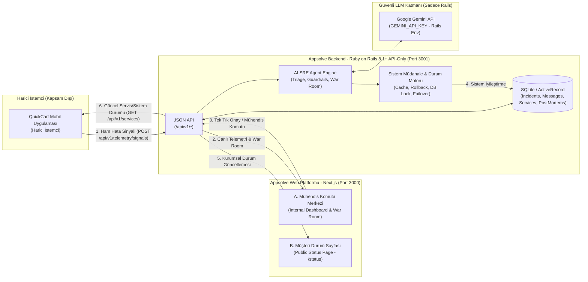

# APPSOLVE — Master İnşa ve Tasarım Planı (`APPSOLVE.OS1`)

Bu doküman, `appsolve product.md` ürün gereksinim dokümanına (PRD), belirlenen teknoloji yığınına (**Next.js + Ruby on Rails 8 API-Only + Google Gemini API**) ve `typesafe.ai` referanslı **Retro-Teknik İş İstasyonu (Retro Workstation)** tasarım diline dayanarak hazırlanmış uçtan uca **Appsolve Web Platformu** inşa planıdır.

> [!IMPORTANT]
> **Kapsam Notu:** QuickCart mobil uygulaması bu projenin dışında (harici istemci olarak) yer alır ve tarafımızca inşa edilmeyecektir. Biz yalnızca **Appsolve Web Platformunu** (Mühendis Komuta Merkezi + Müşteri Durum Sayfası) ve QuickCart mobil uygulamasının hata sinyali gönderip sistem durumunu okuyacağı **Rails 8 JSON API** katmanını inşa edeceğiz.

---

## 1. Mimari Prensipler ve Teknoloji Yığını



* **Frontend (`frontend/`)**: Next.js (App Router, TypeScript, Tailwind CSS). Yalnızca **Mühendis Komuta Merkezi (Internal Dashboard)** ve **Müşteri Durum Sayfası (Public Status Page)** yüzeylerinden oluşur. Tarayıcıda **hiçbir AI API anahtarı veya doğrudan LLM çağrısı bulunmaz**; tüm iletişim Rails JSON API (`/api/v1/...`) üzerinden yürütülür.
* **Backend (`backend/`)**: Ruby 4.0.1 + **Ruby on Rails 8.1+ (`rails new backend --api`)**. Harici QuickCart uygulamasından gelen ham hata sinyallerini karşılar, `GEMINI_API_KEY` ortam değişkeni üzerinden **Google Gemini API** çağrılarını yürütür, SEV Guardrail (Otonomi Kilidi) kurallarını işletir ve çözüm uygulandığında ilgili servis durumlarını günceller.
* **Gerçek Zamanlı Senkronizasyon**: Harici QuickCart uygulamasından bir hata sinyali geldiği anda Mühendis Komuta Merkezi ve Müşteri Status Page sayfaları yenilenmeye gerek kalmadan (düşük gecikmeli reaktif JSON senkronizasyonu / SSE ile) canlı güncellenir.

---

## 2. Görsel Tasarım Sistemi (`frontend-design` İki Aşamalı Tasarım Planı)

### Aşama 1: Tasarım Sistemi, Renk Tokenları, Tipografi ve Yerleşim

#### A. Konsept: `APPSOLVE.OS1` — Retro-Teknik SRE İş İstasyonu
`typesafe.ai` referans alınarak; tipik yuvarlatılmış SaaS kartları, bulanık gölgeler (`rgba(0,0,0,0.1)`) ve yapay "sohbet botu" klişeleri tamamen reddedilmiştir. Arayüz; erken dönem mühendislik iş istasyonları (classic Mac System 7 / NeXTSTEP / Xerox Alto) ve endüstriyel kontrol panellerinden ilham alan, **pencere tabanlı (`Window Chrome 1.1`), keskin kenarlı (`0px` border-radius), tablo ve ızgara (grid) odaklı** bir komuta merkezidir.

#### B. Renk Paleti (ColorHunt Paleti + Beyaz)
Belirlenen 4 ana renk + Beyaz (`https://colorhunt.co/palette/522d6080426ef2a67bffd38b` + `#FFFFFF`), yüzey hiyerarşisini ve SEV durumlarını kodlamak için şu token sistemiyle kullanılır:

| Token Adı | Hex Değeri | Rolü ve Kullanım Alanı |
| :--- | :--- | :--- |
| `--os-ink` (Derin Mürdüm) | `#522D60` | **Ana Yapısal Çizgi & Metin:** Saf siyah (`#000`) yerine tüm `1.5px`/`2px` pencere çerçeveleri, sert piksel gölgeler (`3px 3px 0px #522D60`), ana tipografi ve terminal başlık çubukları. |
| `--os-mulberry` (Bordo/Mor) | `#80426E` | **İkincil Pencere & Aktif Sekme:** Yardımcı modül başlıkları (`Triage.1.1`, `Timeline.1.1`), seçili olay satırı vurgusu, `SEV-1` alarm atmosferinin yapısal çerçevesi. |
| `--os-apricot` (Sıcak Kayısı/Mercan) | `#F2A67B` | **Etkileşim & SEV-2 / Eylem Vurgusu:** Birincil aksiyon butonları (`[ONAYLA VE UYGULA]`), "Eylem Kartı" çerçeveleri, `SEV-2` (Majör) durum rozetleri ve odak göstergeleri. |
| `--os-amber` (Retro Kehribar) | `#FFD38B` | **Telemetri & SLA / Uyarı Işığı:** SLA geri sayım sayacı zemini, `SEV-3` (Otonom) işlem vurguları, canlı ajan düşünce (Reasoning) vurgusu ve durum göstergeleri. |
| `--os-paper` (Kırılmaz Beyaz) | `#FFFFFF` | **Ana Tuval & Pencere İçeriği:** `typesafe.ai` gibi ferah, yüksek kontrastlı ana çalışma yüzeyi ve veri tabloları zemini (`#FAF6F2` hafif sıcak noktalı/ızgaralı alt zemin ile desteklenir). |
| `--os-crimson` (Kritik Alarm) | `#D9383A` | **SEV-1 Kırmızı Alarm Sinyali:** Paletle uyumlu retro sinyal kırmızısı; yalnızca `SEV-1` (Tam Çöküş) durumunda başlık alarmında ve kesinti (Outage) rozetinde kullanılır. |
| `--os-phosphor` (Terminal Yeşili) | `#1E8E5A` | **Sistem Sağlıklı / Çözüldü:** Servislerin `OPERATIONAL` (Çalışıyor) durumunda ve olay çözüldüğünde (`RESOLVED`) yanan retro LED göstergesi. |

#### C. Tipografi
* **Birincil Teknik & Başlık Yazı Tipi (`--font-mono`):** `IBM Plex Mono` veya `JetBrains Mono`. Pencere başlık çubukları (`WarRoom 1.1`, `Triage Engine 1.1`), zaman damgaları (`22:46:14.08`), SLA sayaçları, SEV rozetleri, sistem metrikleri ve buton metinlerinde kullanılır.
* **Okuma & Rapor Yazı Tipi (`--font-sans`):** `Space Grotesk` / `Inter`. War Room içindeki uzun mesajlar, AI hipotez açıklamaları, Post-Mortem rapor metinleri ve Müşteri Status Page açıklamalarında yüksek okunabilirlik sağlar (satır uzunluğu `< 75` karakter).

#### D. ASCII Yerleşim Planı (Layout & Wireframe)

**Yüzey A: Mühendis Komuta Merkezi (`/`)**
```text
+--------------------------------------------------------------------------------------------------+
| [≡] APPSOLVE.OS1 // SRE COMMAND WORKSTATION             [KOMUTA MERKEZİ] [STATUS PAGE] [22:48:01]|
+--------------------------------------------------------------------------------------------------+
| ! SEV-1 ACTIVE ALARM: PAYMENT GATEWAY DEADLOCK   | AUTONOMY LOCK: MANUAL_ONLY | SLA: 00:14:22 !  |
+---------------------------+------------------------------------------+---------------------------+
| [□] INCIDENT_QUEUE 1.1    | [□] WAR_ROOM 1.1 (ACTIVE COLLABORATION)  | [□] AI_TRIAGE_HYPOTHESIS  |
|---------------------------|------------------------------------------|---------------------------|
| > #INC-409 [SEV-1] ACTIVE | [22:46:02] AI_SRE_AGENT:                 | SEVERITY: SEV-1 (CRITICAL)|
|   Checkout 504 Timeout    | Ödeme servisinde %94 hata oranı tespit   | IMPACT: Ödeme akışı durdu.|
|                           | edildi. DB lock tablosunda 48 bekliyor.  | GUARDRAIL: 🔒 TAM KİLİT    |
|   #INC-408 [SEV-2] WAIT   |                                          | (Sadece Mühendis Komutu)  |
|   Cart Coupon NaN Error   | +--------------------------------------+ |---------------------------|
|                           | | [ACTION CARD: PLAN #04]              | | [□] INCIDENT_TIMELINE 1.1 |
|   #INC-407 [SEV-3] AUTO   | | Hipotez: Redis Promo Cache Bozulması | |---------------------------|
|   Image CDN Cache Bloat   | | Adım 1: promo_v2 bayrağını geri al   | | 22:46:01 Sinyal yakalandı |
|   (Resolved by AI in 4s)  | | [ ONAYLA VE UYGULA ]  [ REDDET ]     | | 22:46:03 SEV-1 belirlendi |
|                           | +--------------------------------------+ | 22:46:04 On-Call + Lead   |
|                           |                                          |          uyandırıldı      |
|                           | [Komut veya mesaj yazın...      ] [GÖNDER]| 22:46:10 Hipotez üretildi |
+---------------------------+------------------------------------------+---------------------------+
| [□] POST_MORTEM_VIEWER 1.1 (Olay çözüldüğünde otomatik rapor: Özet, Kök Neden, MTTR, Aksiyonlar) |
+--------------------------------------------------------------------------------------------------+
```

**Yüzey B: Müşteri Durum Sayfası (`/status`)**
```text
+--------------------------------------------------------------------------------------------------+
| [≡] QUICKCART SYSTEM STATUS // PUBLIC TELEMETRY 1.1                    [ALL SYSTEMS / INCIDENTS] |
+--------------------------------------------------------------------------------------------------+
| [ GENEL DURUM: KISMİ PERFORMANS KAYBI / İNCELENİYOR ]                        Güncelleme: Canlı   |
+--------------------------------------------------------------------------------------------------+
| [□] SERVICE_HEALTH_MATRIX 1.1                                                                    |
| +----------------------+----------------------+----------------------+-------------------------+ |
| | GİRİŞ (AUTH)         | KATALOG (CATALOG)    | SEPET (CART)         | ÖDEME (CHECKOUT)        | |
| | [●] ÇALIŞIYOR        | [●] ÇALIŞIYOR        | [▲] PERFORMANS KAYBI | [■] KESİNTİ             | |
| +----------------------+----------------------+----------------------+-------------------------+ |
|                                                                                                  |
| [□] PUBLIC_INCIDENT_FEED 1.1 (AI Destekli Kurumsal Müşteri İletişimi — SEV-3 Gizli Tutulur)      |
| - [22:47] İNCELENİYOR: Ödeme işlemlerinde yaşanan gecikme ekibimiz tarafından incelenmektedir.   |
| - [22:48] SORUN TESPİT EDİLDİ: Neden belirlendi, iyileştirme çalışması uygulanıyor.              |
| - [22:49] ÇÖZÜLDÜ: Tüm QuickCart servisleri normal çalışma düzenine dönmüştür.                   |
+--------------------------------------------------------------------------------------------------+
```

### Aşama 2: `frontend-design` Öz-Eleştiri (Self-Critique) ve Kalibrasyon
* **Nelerden Kaçınıldı?**
  1. Klişe koyu arka plan + neon yeşil siberpunk görünümü yerine; `typesafe.ai`'nin **beyaz kağıt zemin (`#FFFFFF`) üzerine keskin `#522D60` çerçeveli** aydınlık, teknik ve yüksek kontrastlı iş istasyonu estetiği seçildi.
  2. Yuvarlatılmış SaaS kartları (`border-radius: 12px`) ve bulanık gölgeler tamamen kaldırıldı; her modül başlık çubuğunda sürüm kodu (`WarRoom 1.1`, `Status.1.1`) taşıyan sert çerçeveli bir penceredir.
  3. Rastgele dekoratif numaralandırmalar (`01 / 02 / 03`) kaldırıldı; numaralar yalnızca gerçek sıralı süreçlerde (Adım 1/2/3 Triage akışı, olay ID'leri `#INC-101` ve milisaniyelik Timeline) kullanılır.

---

## 3. İnşa Edilecek Modüller ve Adım Adım Master Plan

Uygulama toplam **7 ardışık modülde** inşa edilecektir. Her adımda ilgili modül uçtan uca tamamlanacak ve aşağıdaki **Bitiş Kriterleri (Definition of Done)** doğrulandıktan sonra bir sonraki adıma geçilecektir.

---

### Adım 1 (Modül 1): Proje İskeleti, Rails 8 API Temeli, Telemetri Giriş Noktası ve `APPSOLVE.OS1` Tasarım Sistemi
**Amaç:** Next.js ve Rails 8 API-only projelerinin ayağa kaldırılması, harici QuickCart uygulamasının konuşacağı JSON API uç noktalarının ve veritabanı şemasının kurulması, `typesafe.ai` + ColorHunt paletli retro pencere bileşen kütüphanesinin oluşturulması.

* **Yapılacaklar:**
  * `backend/`: Ruby 4.0.1 + Rails 8.1 (`rails new backend --api`) kurulumu, CORS yapılandırması ve `.env` üzerinde `GEMINI_API_KEY` altyapısının hazırlanması.
  * Temel modellerin ve tabloların oluşturulması: `Service` (`Giriş`, `Katalog`, `Sepet`, `Ödeme`), `Incident` (başlık, sev, durum, autonomy_mode, hypothesis, reasoning, sla_deadline, raw_payload), `IncidentEvent` (Timeline kayıtları), `WarRoomMessage` (mesajlar ve Action Card JSON verisi), `PostMortem` ve `StatusUpdate`.
  * Harici QuickCart mobil uygulamasının hata sinyali göndereceği `POST /api/v1/telemetry/signals` ve servislerin güncel sağlık durumunu sorgulayacağı `GET /api/v1/services` uç noktalarının açılması.
  * `frontend/`: Next.js kurulumu, `#522D60`, `#80426E`, `#F2A67B`, `#FFD38B`, `#FFFFFF` CSS değişkenlerinin ve `RetroWindow` (`1.1` başlık çubuklu), `RetroBadge`, `RetroButton`, `RetroClock` (`Clock Tool 1.1`) bileşenlerinin oluşturulması.
* **Bitiş Kriterleri (Definition of Done):**
  1. `backend` sunucusu `localhost:3001` üzerinde hatasız çalışmalı; `GET /api/v1/services` QuickCart'ın 4 ana servisini (`Giriş`, `Katalog`, `Sepet`, `Ödeme`) JSON olarak dönmeli ve `POST /api/v1/telemetry/signals` dışarıdan gelen ham hata JSON yükünü kabul etmeli.
  2. `frontend` uygulaması `localhost:3000` üzerinde açılmalı, Rails API'den verileri çekip `APPSOLVE.OS1` retro pencere tasarımıyla ve ColorHunt renk paletiyle ekranda göstermeli.
  3. Tarayıcı kaynak kodunda veya ağ isteklerinde hiçbir harici API anahtarı bulunmamalı (`GEMINI_API_KEY` yalnızca Rails tarafında kalmalı).

---

### Adım 2 (Modül 2): Çekirdek AI SRE Ajanı — Bağlamsal Triage, SEV Kararı ve Guardrail Motoru (Rails + Gemini API)
**Amaç:** Harici uygulamadan gelen ham hata sinyalinde hazır bir SEV seviyesi aramadan, Google Gemini API kullanarak hatanın **iş etkisini (Business Impact)** analiz edip `SEV-1`, `SEV-2` veya `SEV-3` kararı veren ve **Otonomi Kilidini (Guardrails)** devreye sokan Rails AI motorunun kurulması.

* **Yapılacaklar:**
  * Rails içinde `AiSre::GeminiClient` ve `AiSre::TriageService` servislerinin yazılması (yalnızca Rails ortam değişkeninden `GEMINI_API_KEY` okur).
  * **Adım 1 (Bağlamsal Triage):** Ham sinyali analiz edip JSON şemasında `severity` (`SEV-1` | `SEV-2` | `SEV-3`), `business_impact_reasoning` (neden bu seviyeyi seçtiğinin açıklaması), `root_cause_hypothesis` (kök neden tahmini) ve `recommended_action_plan` üretmesi.
  * **Adım 2 (SEV Tabanlı Yetki Kısıtlaması & Akıllı Eskalasyon):**
    * `SEV-3` -> `autonomy_mode: full_autonomy`, eskalasyon: `none` (Kimse rahatsız edilmez).
    * `SEV-2` -> `autonomy_mode: approval_required`, eskalasyon: `on_call_engineer` (Nöbetçi mühendis çağrılır).
    * `SEV-1` -> `autonomy_mode: manual_command_only`, eskalasyon: `on_call_and_team_lead` (Nöbetçi Mühendis + Takım Lideri çağrılır), `sla_deadline: 15.minutes.from_now`.
  * Her karar adımının `IncidentEvent` (Timeline) tablosuna saniyesiyle işlenmesi.
* **Bitiş Kriterleri (Definition of Done):**
  1. `POST /api/v1/telemetry/signals` uç noktasına içinde SEV derecesi bulunmayan ham bir hata sinyali gönderildiğinde, Rails üzerindeki Gemini AI Ajanı iş etkisini değerlendirip doğru `SEV-1`, `SEV-2` veya `SEV-3` kararını, gerekçesini ve hipotezini üretmeli.
  2. Belirlenen SEV seviyesine göre `autonomy_mode` (Otonomi Kilidi) ve eskalasyon kayıtları veritabanında otomatik oluşmalı; Guardrail katmanı `SEV-1` ve `SEV-2`'de izinsiz otonom sistem müdahalesini kod seviyesinde engellemeli.

---

### Adım 3 (Modül 3): Mühendis Komuta Merkezi — Canlı Olay Listesi, SEV-Duyarlı Başlık, AI Triage ve Timeline
**Amaç:** PRD Bölüm 3.A'daki 1., 2. ve 4. modüllerin (`Canlı Olay Listesi ve SEV-Duyarlı Başlık`, `AI Triage & Hipotez Paneli`, `Canlı Zaman Çizelgesi`) Next.js üzerinde inşa edilmesi.

* **Yapılacaklar:**
  * **Canlı Olay Listesi ve SEV-Duyarlı Başlık (`IncidentQueue 1.1` & `HeaderBar`):** Aktif olayların listelendiği sol panel ve `SEV-1` durumunda kırmızı alarm moduna geçerek canlı **SLA Geri Sayım Sayacını (`00:14:59`)** ve eskalasyon bilgisini gösteren üst bar.
  * **AI Triage & Hipotez Paneli (`TriageEngine 1.1`):** Ajanın olaya neden o SEV derecesini verdiğini (düşünce sürecini / iş etkisi analizini), kök neden tahminini ve aktif **Otonomi Kilidi (Guardrail)** durumunu gösteren özet penceresi.
  * **Canlı Zaman Çizelgesi (`IncidentTimeline 1.1`):** Olayın başlangıcından çözümüne kadar gerçekleşen her kritik adımın (`Hata alındı -> SEV belirlendi -> Mühendis çağrıldı -> Aksiyon alındı -> Çözüldü`) saniye saniye işlendiği görsel akış.
* **Bitiş Kriterleri (Definition of Done):**
  1. API'ye yeni bir hata sinyali düştüğünde Komuta Merkezi'nde olay anında belirmeli; AI Triage panelinde ajanın neden o SEV derecesini verdiği ve kök neden hipotezi net şekilde okunabilmeli.
  2. `SEV-1` olayında üst başlık kırmızı alarm moduna geçmeli, SLA sayacı geri saymaya başlamalı ve Timeline her adımı saniye saniye listelemeli.

---

### Adım 4 (Modül 4): Yol A (`SEV-3` Tam Otonom Çözüm) ve Yol B (`SEV-2` Tek Tıkla Plan Onayı & Eylem Kartı)
**Amaç:** PRD Bölüm 2 Adım 3'teki **Yol A (Tam Otonom Çözüm)** ve **Yol B (İnsan Onaylı Hızlı Çözüm / Tek Tıkla Plan Onayı)** senaryolarının hem Rails hem de Next.js War Room arayüzünde tamamlanması.

* **Yapılacaklar:**
  * **Yol A (`SEV-3` İnsansız Akış):** Ajan hipotezini oluşturur -> `full_autonomy` yetkisiyle ilgili sistem düzeltmesini (Örn: Önbellek temizleme, kaynak artırma) kendi başına uygular -> Servisin düzeldiğini doğrular -> Olayı kapatır (`resolved`).
  * **Yol B (`SEV-2` Tek Tıkla Plan Onayı):** Ajan olayı oluşturur -> **War Room (Canlı Sohbet Odası)** anında açılır -> Nöbetçi mühendise bildirim düşer -> Ajan War Room içine **Hipotezini** ve hazırladığı **Çözüm Planını** içeren interaktif bir **"Eylem Kartı" (`ActionCard 1.1`)** bırakır.
  * Mühendis kart üzerindeki **`[Onayla ve Uygula]`** butonuna tek tıkla bastığında (`POST /api/v1/incidents/:id/approve_plan`), ajan planı uygular, ilgili servisi `operational` durumuna döndürür ve olayı kapatır *(Mühendis isterse butona basmayıp chat üzerinden ajana farklı bir talimat da verebilir)*.
* **Bitiş Kriterleri (Definition of Done):**
  1. `SEV-3` seviyesinde bir hata sinyali geldiğinde hiçbir insan müdahalesi olmadan ajan çözümü uygulayıp olayı otomatik kapatmalı.
  2. `SEV-2` seviyesinde bir hata sinyali geldiğinde ajan doğrudan müdahale etmeyip War Room'a **Eylem Kartı** bırakmalı; mühendis `[Onayla ve Uygula]` butonuna bastığı anda plan uygulanmalı, servis durumu düzelmeli ve olay kapanmalı.

---

### Adım 5 (Modül 5): Yol C (`SEV-1` Aktif War Room İşbirliği, Mühendis-Ajan Sohbeti ve Canlı SEV Düşürme)
**Amaç:** PRD Bölüm 2 Adım 3'teki **Yol C (Mühendis + Ajan Ortak Çözümü)** ve Bölüm 3.A.3 (**Her Daim Aktif War Room**) modülünün tüm yetenekleriyle tamamlanması.

* **Yapılacaklar:**
  * **Her Daim Aktif War Room (`WarRoom 1.1`):** On-call tetiklendiği andan itibaren açık olan, içinde mühendis-ajan gerçek zamanlı mesajlaşmalarının, sistem metrik/bulgu çıktılarının ve eylem kartlarının yer aldığı merkezi çalışma alanı.
  * **Rails + Gemini AI War Room Orkestratörü (`POST /api/v1/incidents/:id/messages`):**
    * `SEV-1` olayında ajan elindeki tüm bulguları, sistem metriklerini ve ilk hipotezini sohbet odasına yazar.
    * Mühendis ve ajan sohbet ekranında karşılıklı soru-cevap ve komutlarla ilerler (Örn: Mühendis: *"Aktif kilitli işlemleri kontrol et"*, Ajan: *"Kontrol ettim, şu işlem kilitli görünüyor"*, Mühendis: *"O işlemi sonlandır ve yedek kaynağı devreye al"*).
    * **Canlı SEV Düşürme (`SEV-1 -> SEV-2` Downgrade):** Krizin şiddeti azaldıkça ajan olayın seviyesini canlı olarak düşürür, ekran kırmızı alarm modundan çıkar; sorun tamamen çözüldüğünde olay kapatılır.
* **Bitiş Kriterleri (Definition of Done):**
  1. `SEV-1` krizinde mühendis War Room üzerinden ajana doğal dilde tanı ve müdahale talimatları verebilmeli; Gemini AI ajanı bu talimatları işleyip sistem araçlarını çalıştırarak gerçekçi teknik çıktılarla yanıt vermeli.
  2. Kriz hafiflediğinde olayın seviyesi canlı olarak `SEV-1`'den `SEV-2`'ye düşürülebilmeli ve nihai çözümde olay `resolved` durumuna geçmeli.

---

### Adım 6 (Modül 6): Otomatik Post-Mortem Görüntüleyici (`PostMortem 1.1`)
**Amaç:** PRD Bölüm 3.A.5'teki **Otomatik Post-Mortem Görüntüleyici** modülünün inşası.

* **Yapılacaklar:**
  * Olay çözüldüğü anda (Yol A, Yol B veya Yol C üzerinden) Rails tarafındaki Gemini AI ajanının tüm olay zaman çizelgesini, War Room yazışmalarını ve uygulanan aksiyonları sentezleyerek otomatik **Post-Mortem** raporu üretmesi.
  * Rapor içeriği: **Özet (Executive Summary), Kök Neden (Root Cause), Etki Süresi (Duration & MTTR), Etkilenen Servisler ve Alınan Aksiyonlar (Action Items)**.
  * Komuta Merkezi içinde yapılandırılmış retro doküman penceresi (`PostMortem 1.1`) olarak anında görüntülenmesi.
* **Bitiş Kriterleri (Definition of Done):**
  1. Bir olay (`SEV-3`, `SEV-2` veya `SEV-1`) çözüldüğü saniye veritabanında otomatik Post-Mortem kaydı oluşmalı ve Komuta Merkezi ekranında tüm zorunlu başlıklarıyla (Özet, Kök Neden, Etki Süresi, Alınan Aksiyonlar) belirmeli.

---

### Adım 7 (Modül 7): Müşteri Durum Sayfası (`Public Status Page`) ve AI Destekli Müşteri İletişimi
**Amaç:** PRD Bölüm 3.B'deki **Müşteri Durum Sayfası (Public Status Page)** yüzeyinin ve AI destekli kurumsal iletişim motorunun tamamlanması.

* **Yapılacaklar:**
  * **Servis Sağlık Göstergeleri (`/status`):** QuickCart müşterilerinin gördüğü herkese açık sayfada **Giriş, Katalog, Sepet ve Ödeme** servislerinin anlık durumunun (`Çalışıyor`, `Performans Kaybı`, `Kesinti`) renklerle ve retro durum göstergeleriyle sunulması.
  * **AI Destekli Müşteri İletişimi:**
    * İçeride teknik bir kriz yaşanırken, Gemini AI ajanının bu durumu teknik terimlerden (`DB lock`, `HTTP 504`, `stack trace`, `cache flush`) tamamen arındırarak müşteriye uygun, kurumsal bir dille otomatik yayınlaması.
    * **SEV Filtresi:** `SEV-3` olayları müşteriye yansıtılmaz (Status Page tamamen yeşil kalır). `SEV-2` ve `SEV-1` olaylarında ise şeffaf durum güncellemeleri (`İnceleniyor -> Sorun Tespit Edildi -> Çözüldü`) otomatik paylaşılır ve çözüm anında tüm göstergeler yeşile (`Çalışıyor`) döner.
* **Bitiş Kriterleri (Definition of Done):**
  1. `SEV-3` olayı yaşandığında `/status` sayfasında hiçbir kesinti veya bildirim görünmemeli, tüm servisler yeşil kalmalı.
  2. `SEV-2` ve `SEV-1` olaylarında ilgili servis kartı anında renk değiştirmeli, teknik terim içermeyen kurumsal AI durum güncellemeleri (`İnceleniyor -> Sorun Tespit Edildi -> Çözüldü`) canlı olarak yayınlanmalı ve olay çözüldüğü saniye Status Page yeşile dönmeli.
